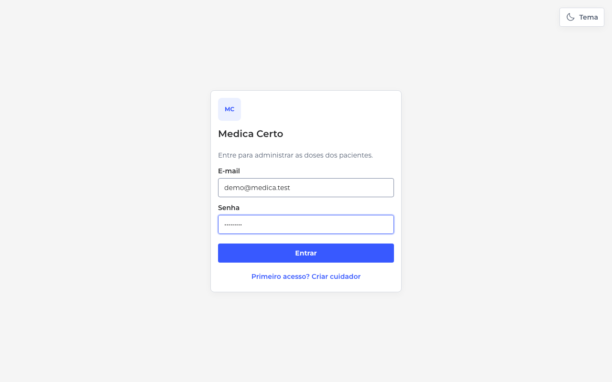
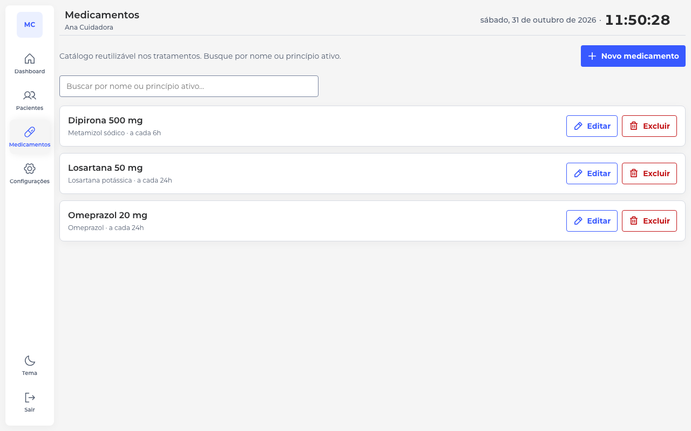
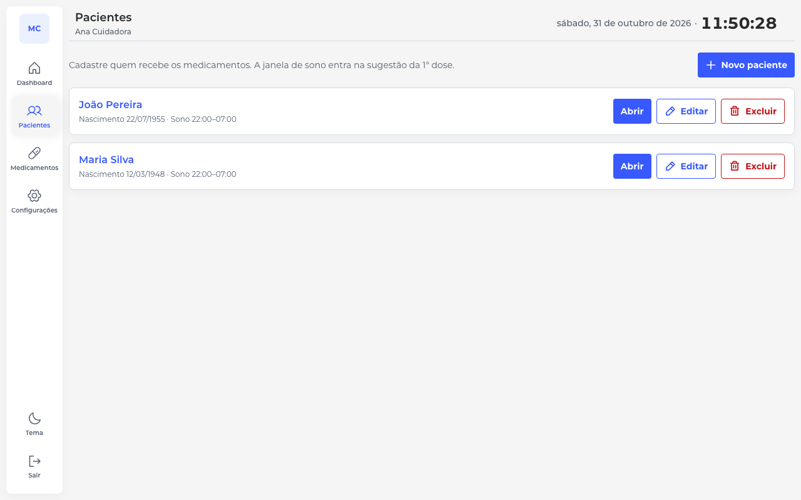
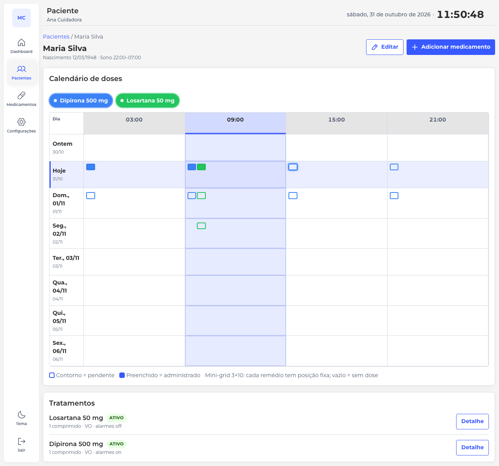
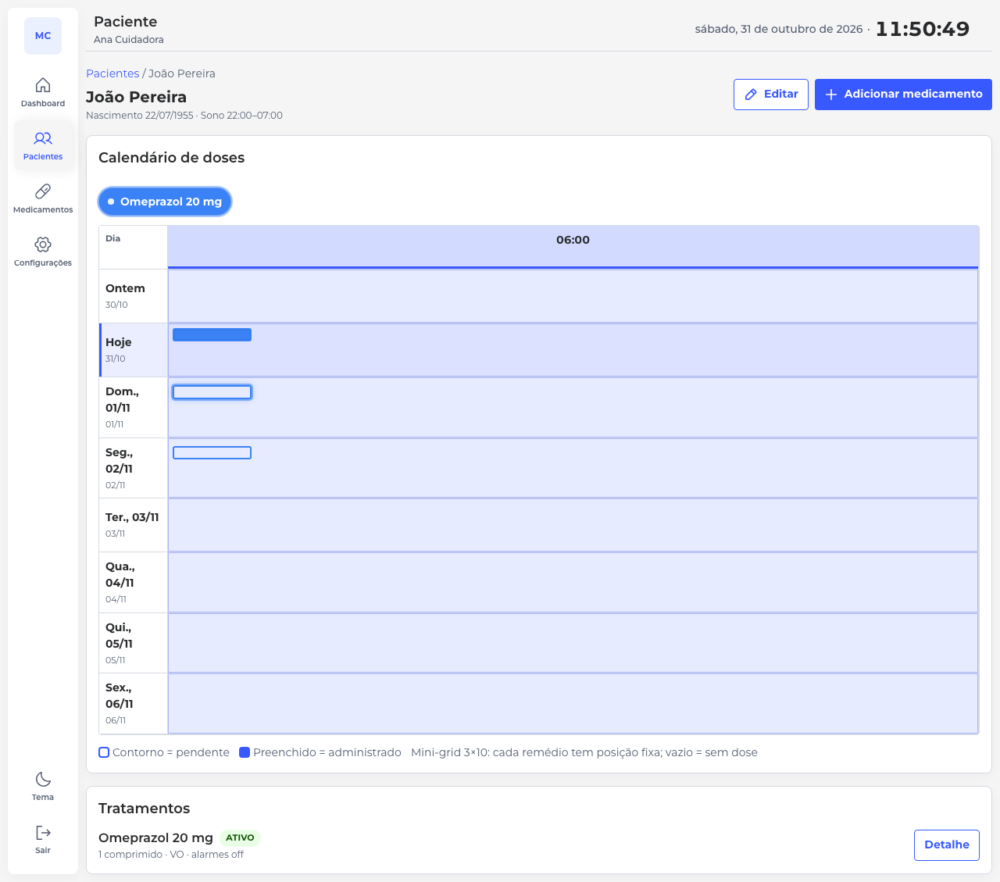
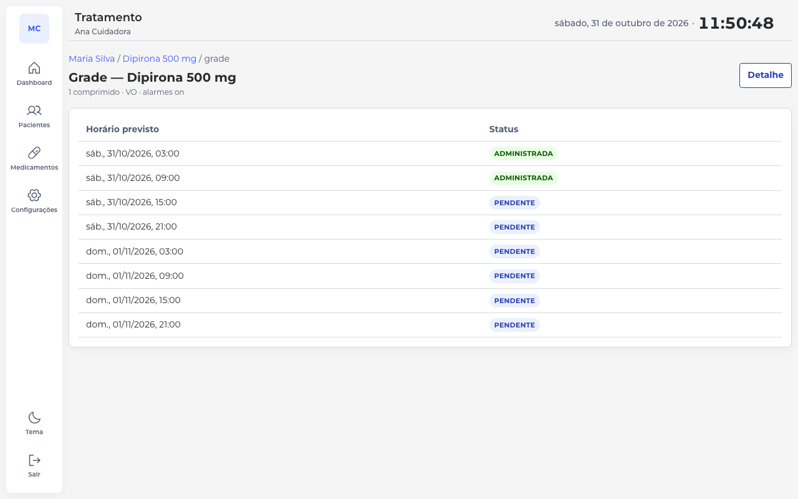
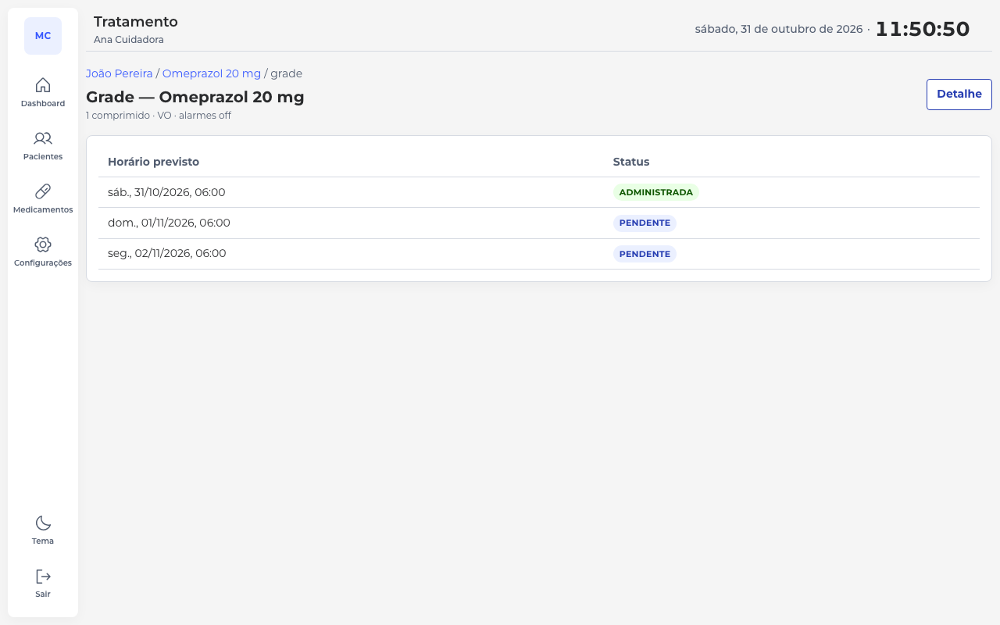
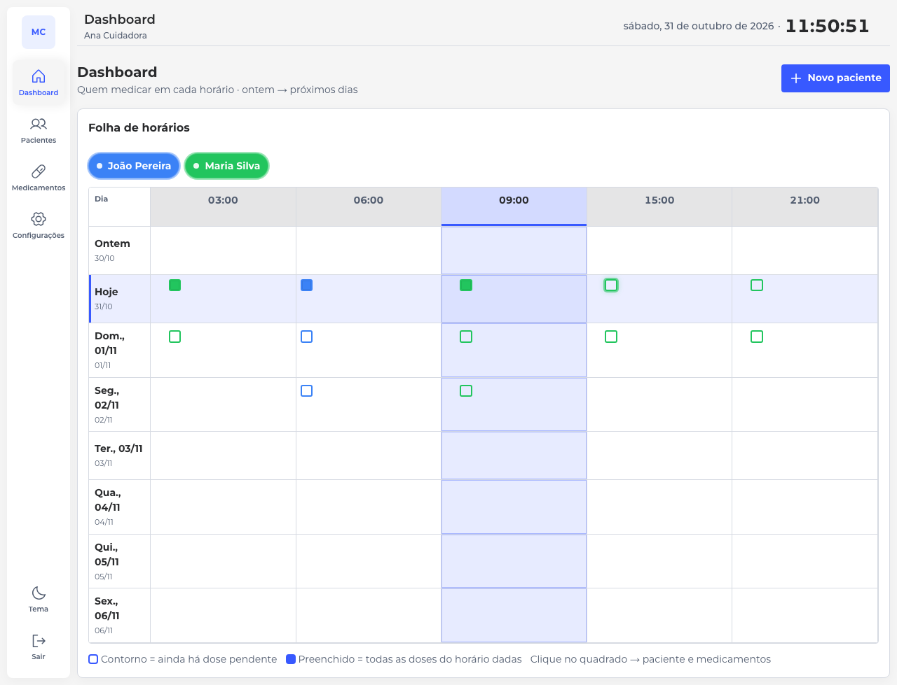

# Medica Certo

Webapp para cuidadores administrarem medicamentos a um ou mais pacientes.  
Produção alvo: **`medica-certo.altamir.dev`** (VPS Hostinger / Traefik).

Documentação: `CONTEXT.md`, `docs/prd.md`, `docs/design.md`, `docs/roadmap.md`.

## Pré-requisitos

- Node.js ≥ 22
- Docker (Postgres local)

## Desenvolvimento local

```bash
./start.sh          # Postgres (Docker) + Fastify (:8080) + Vite (:5173)
./start.sh --prod   # build da web; Fastify serve API + SPA na :8080
```

Equivalente manual:

```bash
cp .env.example .env
docker compose up -d postgres
npm install
npm run dev
```

- UI: http://127.0.0.1:5173 (`WEB_PORT` no `.env` se a porta estiver ocupada)  
- API: http://127.0.0.1:8080/api/health  

O Vite faz proxy de `/api` para o Fastify. Ctrl+C no `start.sh` para API/web; o Postgres no Docker permanece (`docker compose stop postgres` se quiser derrubar).

## Conta demo (local)

Seed gerado via Playwright para os prints abaixo:

| Campo | Valor |
| --- | --- |
| E-mail | `demo@medica.test` |
| Senha | `demo12345` |
| Nome | Ana Cuidadora |

Pacientes de exemplo: **Maria Silva**, **João Pereira**.  
Medicamentos: Dipirona 500 mg, Losartana 50 mg, Omeprazol 20 mg.

Para regenerar os prints (app precisa estar no ar):

```bash
# opcional: npm install -D @playwright/test && npx playwright install chromium
MC_BASE_URL=http://127.0.0.1:5179 node scripts/demo-screenshots.mjs
```

## Telas

### Login



### Catálogo de medicamentos



### Pacientes



### Folha do paciente (doses ministradas)

Chips preenchidos = dose administrada. Contorno = pendente.





### Grade de doses





### Dashboard



## Stack (ADR 001)

Node 22 ESM · Fastify · PostgreSQL (`pg`) · Vite/React/TS · UI com CSS variables · deploy Docker 1 réplica.

## Auth (PR2 / ADR 003)

- Cookie `mc_session` (HttpOnly, SameSite=Lax; `Secure` em produção)
- Primeiro cuidador: tela **Criar cuidador** em `/login`, ou seed `BOOTSTRAP_EMAIL` / `BOOTSTRAP_PASSWORD` no `.env`
- Depois do primeiro cadastro, `POST /api/auth/register` responde `409 BOOTSTRAP_CLOSED`

## Pacientes (PR3 / R2)

- Rotas: `GET/POST /api/patients`, `GET/PUT/DELETE /api/patients/:id`
- UI: `/pacientes`, `/pacientes/novo`, `/pacientes/:id`
- Janela de sono padrão `22:00–07:00`; `DELETE` responde `409 CONFLICT` se houver tratamento ativo

## Medicamentos e tratamentos

- Catálogo em `/medicamentos` (CRUD + busca)
- Tratamento = paciente + medicamento + esquema de horários + grade de doses
- Folha do paciente e dashboard marcam doses como administradas

## Produção (VPS Hostinger + Traefik)

Push na `main` roda `.github/workflows/deploy.yml`: testes unitários (sem Postgres), build da imagem `linux/amd64` e deploy por SSH. O app escuta só dentro da rede Docker; o Traefik publica `https://medica-certo.altamir.dev`. Postgres não abre porta no host.

Rollback: Actions → Deploy → Run workflow (branch **main**) → `image_tag` = SHA completo (40 hex) de um commit que este workflow já publicou no GHCR. Vazio faz build do HEAD e deploy. O job de rollback não recompila. Um deploy em andamento não é cancelado pelo seguinte.

A tag `:latest` acompanha o último push na `main`. A VPS sobe o SHA gravado em `/docker/medica-certo/image.env`, não a `:latest`.

### Secrets do repositório

O repositório ainda não tem secrets. Em **Settings → Secrets and variables → Actions**, cadastre:

| Secret | Obrigatório | O que é |
|---|---|---|
| `VPS_SSH_KEY` | sim | Chave **privada** OpenSSH (bloco `BEGIN`/`END` e quebras de linha). A pública correspondente fica em `authorized_keys` do usuário da VPS. |
| `VPS_HOST` | sim | IP ou hostname da VPS. |
| `VPS_USER` | sim | Usuário SSH com permissão de `docker` e de escrita em `/docker/medica-certo`. |
| `VPS_PORT` | não | Porta SSH. Se o secret não existir, o workflow usa `22`. |

Não crie secret para o GHCR. O job usa o `GITHUB_TOKEN` do próprio Actions (login no `ghcr.io` durante o deploy; o token não fica no servidor).

O primeiro push na `main` cria o pacote `ghcr.io/altamir-dev/medica-certo`. Pode nascer privado: o workflow mesmo assim faz pull, porque autentica com o token do repositório.

### Uma vez na VPS

O usuário de `VPS_USER` precisa do grupo `docker` e do diretório de deploy:

```bash
sudo mkdir -p /docker/medica-certo
sudo chown "$USER":"$USER" /docker/medica-certo
sudo usermod -aG docker "$USER"
```

Confira o nome da rede do Traefik (não há default no repositório):

```bash
docker network ls
docker inspect <container-do-traefik> --format '{{range $k, $v := .NetworkSettings.Networks}}{{println $k}}{{end}}'
```

O entrypoint e o certresolver precisam bater com o Traefik que já está na VPS. O padrão do Compose é `websecure` e `letsencrypt` (os mesmos labels do compose local). Se os nomes forem outros, defina `TRAEFIK_ENTRYPOINT` e `TRAEFIK_CERTRESOLVER` no `.env`.

### `.env` em `/docker/medica-certo`

Copie `deploy/env.vps.example` para `/docker/medica-certo/.env` e preencha **no servidor**. `chmod 600 .env`. Não commite.

Obrigatório:

- `POSTGRES_PASSWORD` — senha do banco `medica_certo`, usuário `medica`. Só letras, dígitos e `._-` (sem espaço, `$`, `@`, `:`, `/`, `#`, `?`, `%`). O Compose monta o `DATABASE_URL` interno; um `DATABASE_URL` no `.env` é ignorado.
- `TRAEFIK_NETWORK` — nome exato da rede externa do Traefik.

Opcionais no mesmo arquivo: `PUBLIC_HOST` (padrão `medica-certo.altamir.dev`), `TRAEFIK_ENTRYPOINT`, `TRAEFIK_CERTRESOLVER`, `BOOTSTRAP_EMAIL` / `BOOTSTRAP_PASSWORD` / `BOOTSTRAP_NAME` (primeiro cuidador, se a tabela estiver vazia), chaves VAPID (`npx --yes web-push generate-vapid-keys`). Sem VAPID o site sobe e o Web Push fica desligado.

O workflow só copia `docker-compose.yml` e `deploy.sh`. Não sobrescreve `.env`, `image.env` nem `data/`. Volumes:

- `/docker/medica-certo/data/postgres`
- `/docker/medica-certo/data/med-photos` (o script entrega o diretório ao uid `1000`, usuário `node` da imagem)

Migrações: `server/migrations/*.sql` rodam num container efêmero antes de recriar o app e de novo no boot (a segunda passagem não refaz o que já entrou em `schema_migrations`). Se a migração falha, o app que já estava no ar não é trocado. Se `/api/health` não voltar `"status":"ok"`, o job falha.

Subir de novo no servidor, sem novo build:

```bash
cd /docker/medica-certo
docker compose --env-file .env --env-file image.env up -d
```

### DNS de `medica-certo.altamir.dev`

Crie um registro **A** (e **AAAA**, se a VPS tiver IPv6) do host `medica-certo` para o IP público da VPS. Não altere MX, NS nem o apex `altamir.dev` por causa deste app.

O Traefik na VPS precisa terminar TLS nesse host (entrypoint `websecure`, certresolver `letsencrypt`, salvo se o `.env` disser o contrário). As portas 80/443 do Traefik é que precisam estar acessíveis; a porta 8080 do app não é publicada.

### Rede do Traefik

`TRAEFIK_NETWORK` tem de ser uma rede Docker **já existente** e externa. O serviço `app` entra nela; o Postgres fica só na rede `backend` do projeto. O label `traefik.docker.network` usa o mesmo nome, para o proxy não escolher o IP da rede interna.
