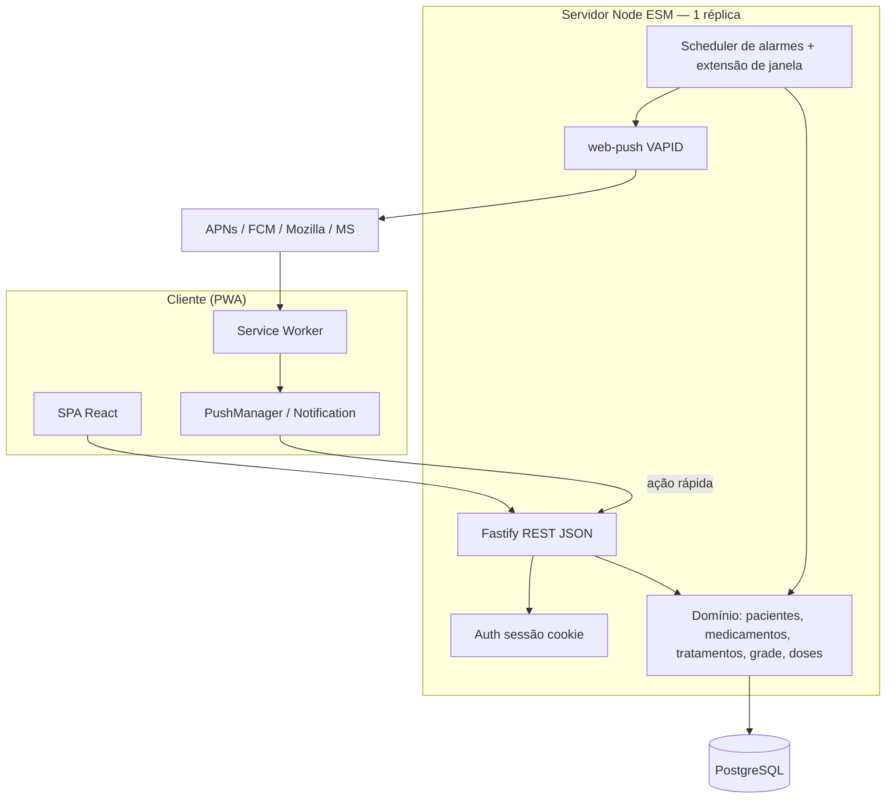
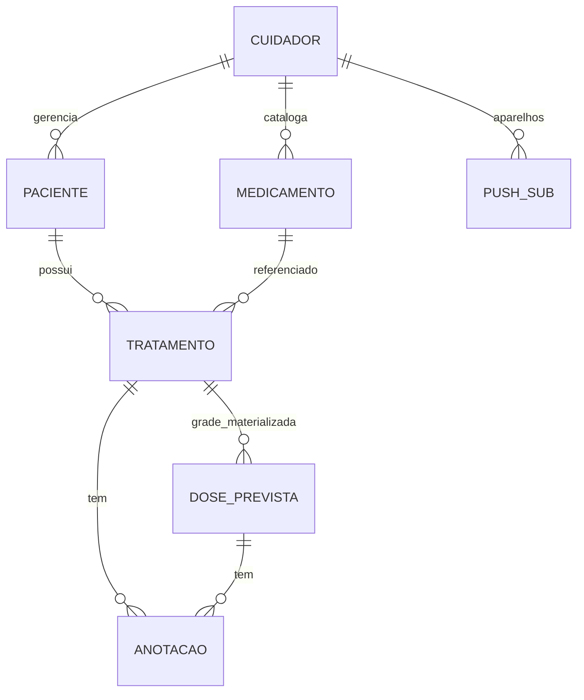
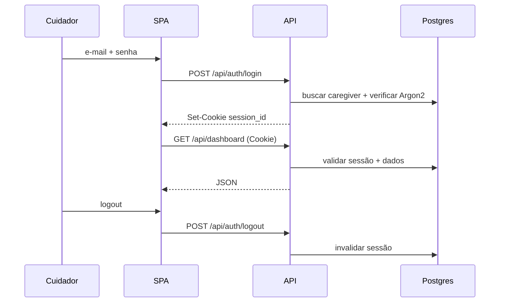
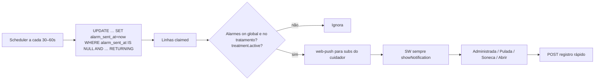

# Design — Medica Certo MVP (Fase 0)

| Campo | Valor |
|---|---|
| **Autor** | TBD |
| **Data** | 2026-10-30 |
| **Status** | Approved |
| **Escopo** | MVP completo (fases 1–5 do roadmap) |
| **Idioma** | pt-BR |
| **Refs** | `docs/prd.md`, `CONTEXT.md`, `docs/roadmap.md` |

---

## Overview

O Medica Certo é um webapp greenfield para um **cuidador** administrar medicamentos a um ou mais **pacientes**, substituindo tabelas em papel e despertadores manuais. O MVP cobre autenticação, cadastros (pacientes e catálogo de medicamentos), **tratamentos** com **esquema de horários** (intervalo regular ou horários customizados), geração de **grade de doses**, **dashboard** com próximas doses, registro de administração/pulada e **alarmes** via PWA / Web Push.

A proposta técnica é um monólito modular em **Node.js 22+ (ESM) + Fastify + PostgreSQL (`pg`) + SPA React (Vite)**, UI obrigatoriamente no casco do portal via **CSS variables** (Montserrat, primary `#3859FF`, sidebar + header + main; sem biblioteca de UI externa no MVP), com notificações no mesmo padrão operacional já validado em `zap-resumos` (`web-push` + Service Worker + restrições iOS). Deploy alvo: **uma réplica** Docker na VPS Hostinger (`alt-vps`) atrás do Traefik em **`medica-certo.altamir.dev`**.

---

## Background & Motivation

Hoje o cuidador:

1. Mantém folhas com paciente, período, medicamentos, intervalo/dose e colunas por dia.
2. Marca `X` (às vezes com hora) ao administrar.
3. Cria despertadores no celular e, ao tocar, consulta a folha.

Isso é frágil: perda da folha, esquema ilegível, esquecimento de alarme e mudança de esquema no meio do curso. O PRD (`docs/prd.md`) e o glossário (`CONTEXT.md`) fecharam o “o quê”; este documento fecha o “como” para a Fase 0 (fundação) e orienta as PRs das fases 1–5.

**Estado atual do repositório:** quase vazio (`ideia.md`, `CONTEXT.md`, `docs/prd.md`, `docs/roadmap.md`). Design a partir do zero, sem legado de código a preservar.

**Volume esperado (doméstico):** tipicamente 1–5 pacientes; centenas de doses na janela rolante; um cuidador autenticado. Latência alvo do dashboard: &lt; 300 ms p95 no servidor sob esse volume (com índices MVP em `scheduled_doses`).

---

## Goals & Non-Goals

### Goals

- Entregar o MVP utilizável no dia a dia (marcos M1–M3 do roadmap).
- Isolar dados por cuidador; sessão segura; UI mobile-first no casco do portal.
- Gerar grade corretamente nos dois modos de esquema, com sugestão de 1ª dose sensível à janela de sono.
- Registrar doses (administrada / pulada / pendente / cancelled) e disparar alarmes no app.
- Fechar decisões em aberto do PRD com defaults conservadores (ver **Key Decisions**).

### Non-Goals (MVP)

- Multi-cuidador / compartilhamento.
- Prescrição formal, farmácia, prontuário, estoque estruturado.
- App nativo; offline completo.
- Relatórios analíticos avançados e exportação “tipo folha” (pós-MVP).
- Paciente como usuário do sistema.
- **Horário silencioso de alarmes** (quiet hours): a janela de sono do paciente serve **somente** à sugestão de 1ª dose (R5). Alarmes de medicamento **disparam mesmo dentro da janela de sono**, salvo se o cuidador desligar alarmes (global ou por tratamento). Não copiar o “horário silencioso 22:00–07:00” do zap-resumos para doses.

---

## Proposed Design

### Arquitetura lógica



**Princípio:** um único processo de aplicação (API + jobs leves em timer) e um banco. Sem microserviços no MVP. Separação clara de pastas (`server/`, `web/`) para evoluir depois se necessário.

**Constraint de deploy (MVP):** `replicas: 1` (um container de app atrás do Traefik). O scheduler in-process não é safe para multi-instância; ver claim idempotente em `alarm_sent_at` abaixo. Escalar horizontalmente exige leader election ou job externo (pós-MVP).

### Stack tecnológica

| Camada | Escolha | Rationale |
|---|---|---|
| Runtime | Node.js ≥ 22, ESM | Alinhado a apps pessoais do autor (`zap-resumos`, `ai-memory-app`); ops conhecida na VPS. |
| API | **Fastify** + JSON REST | Muitas rotas CRUD/ações no MVP; schema/validation nativos; ainda um único processo. |
| Persistência | PostgreSQL 16 + **`pg`** | Driver já usado em `zap-resumos`; modelo relacional; ACID para registro único de dose. Sem `postgres.js` no MVP. |
| Migrações | SQL versionado em `server/migrations/` | Simples, auditável; sem ORM no MVP. |
| Frontend | Vite + React + TypeScript | Formulários e grade mais ricos que HTML estático; tipagem no domínio. |
| UI | Tokens e padrões via **CSS variables** (`:root`) | Hard constraint: Montserrat, `#3859FF`, casco sidebar+header+main. **MVP day-1: sem** biblioteca de UI externa — compor shell e componentes no Vite/React só com as variáveis CSS. Tag variants **somente** `primary` \| `secondary` \| `success` \| `error` \| `disabled`. |
| Auth | E-mail/senha + sessão server-side (cookie `HttpOnly`, `Secure`, `SameSite=Lax`) | Um cuidador; sem OAuth no MVP; magic link adiado (infra de e-mail). |
| Hash de senha | Argon2id (ou scrypt se Argon2 indisponível) | Padrão moderno; custo ajustável. |
| Notificações | PWA + `web-push` (VAPID) | Já validado em `zap-resumos`; iOS 16.4+ exige “Adicionar à Tela de Início”. |
| Deploy | Docker Compose + Traefik na VPS `alt-vps`, **1 réplica** | Padrão ops do autor. |
| Idioma UI / docs | pt-BR | Código e comentários em inglês (preferência global). |

### Estrutura de repositório (proposta)

```text
medica-certo/
  CONTEXT.md
  docs/
    prd.md
    roadmap.md
    design.md          # este documento
    adr/               # 001-stack, 002-web-push, 003-auth-session
  server/
    index.mjs
    config.mjs
    db.mjs
    auth.mjs
    routes/
    domain/            # grade, sugestão de sono, extensão de janela
    push.mjs
    scheduler.mjs
    migrations/
  web/
    index.html
    src/
      App.tsx
      shell/           # casco visual (portal 90px)
      pages/
      components/
      api/
    public/
      manifest.webmanifest
      sw.js
      icons/
  data/                # volume local; med-photos fora do web root
  docker-compose.yml
  Dockerfile
  package.json
```

### Modelo de domínio (mapeamento CONTEXT.md)



> **Nota:** “Grade de doses” é conceito de domínio (`CONTEXT.md`). No físico **não** há tabela `grades` — a grade é o conjunto de linhas em `scheduled_doses` do tratamento. “Dose administrada” **não** é entidade/relação separada: são os atributos `status` e `administered_at` da própria `DOSE_PREVISTA` / `scheduled_doses` (KD13).

| Termo CONTEXT | Entidade / campo técnico | Notas |
|---|---|---|
| Cuidador | `caregivers` | Único papel autenticado no MVP. |
| Paciente | `patients` | `name`, `birth_date`, `sleep_start`, `sleep_end` (default 22:00–07:00). |
| Medicamento | `medications` | Catálogo por cuidador; foto opcional. |
| Princípio ativo | `medications.active_ingredient` | Texto. |
| Posologia | `medications.reference_posology` | Texto de referência do catálogo. |
| Quantidade da dose | `treatments.dose_quantity` | **Obrigatória** no tratamento. |
| Via de administração | `treatments.route` | **Obrigatória** (enum + “outra”). |
| Esquema de horários | `treatments.schedule_mode` + payload | `regular_interval` \| `custom_times`. |
| Intervalo regular | `treatments.interval_hours` | Inteiro N &gt; 0. |
| Tratamento | `treatments` | Início, fim opcional, status `active` \| `ended`. |
| Grade de doses | Conjunto de `scheduled_doses` | Janela gerada (não infinita). |
| Dose prevista | `scheduled_doses` | `scheduled_at`, `status`. |
| Dose administrada | Mesma linha `scheduled_doses` | `status=administered` + `administered_at` (sem tabela 1:1). |
| Anotação | `notes` | `treatment_id` e/ou `scheduled_dose_id`. |
| Dashboard | query de próximas doses | Só tratamentos `active`; agrega pacientes do cuidador. |

**Estados da dose prevista:** `pending` | `administered` | `skipped` | `cancelled`.

- “Atrasada” é visão derivada: `pending` ∧ `scheduled_at` &lt; agora → UI com Tag **`error`** (variante adequada; **não** existe Tag `attention`).
- `cancelled`: doses futuras invalidadas ao encerrar tratamento (ver abaixo); fora de dashboard/upcoming/overdue/alarmes.

**Mudança de esquema:** encerrar tratamento (`ended_at`, status `ended`) + criar novo; atalho UX “Encerrar e recriar” pré-preenche medicamento/paciente/quantidade/via. Campos de esquema **não** são PATCH-áveis (ver tabela PATCH).

### Algoritmo de geração da grade

Timezone: **America/Sao_Paulo** (fixável no cuidador no pós-MVP; MVP fixo BRT). Armazenar instantes em `timestamptz` (UTC) e exibir no fuso do app.

**Limite superior (`ends_limit` / `range_end`) — PRD R4.4:**

- Se `ends_on` (date) informado (**curso com fim**): `ends_limit` = fim **inclusivo** do dia calendário = `ends_on` 23:59:59.999 em America/Sao_Paulo. **`range_end = ends_limit`** — gerar a grade **inteira** do início ao fim. A janela rolante de 7 dias **não** se aplica. (Safety opcional no MVP: rejeitar ou truncar só cursos absurdos com `ends_on − starts_at` &gt; **366 dias**, nunca o cap de 7d.)
- Se contínuo (`ends_on` NULL): `range_end = max(starts_at, now) + 7 days` na criação/extensão (KD2).

**Geração na criação / preview** (inclui `starts_at` no passado — digitação da folha, marcos M1/M5):

```
se ends_on presente:                          # curso com fim — grade completa (R4.4)
  range_start ← starts_at
  range_end ← ends_limit
  truncatedBackfill ← false
senão:  # contínuo
  range_start ← max(starts_at, now − 31 days) # cap de backfill
  range_end ← max(starts_at, now) + 7 days
  truncatedBackfill ← (range_start > starts_at)
gerar todas as doses com scheduled_at ∈ [range_start, range_end]
```

- Doses com `scheduled_at` &lt; now nascem `pending` e aparecem como **atrasadas** no dashboard/grade (backfill do papel).
- Cap de backfill de **31 dias** aplica-se **somente** a tratamentos contínuos; cursos com `ends_on` materializam a grade inteira (necessário para migrar folhas antigas / marco M1).
- `POST /api/treatments/preview` usa **a mesma** função/regra de limites (sem persistir).

#### Modo `regular_interval`

Entrada: `first_dose_at` (= `starts_at`), `interval_hours` N, `ends_limit` ou `window_end`.

```
t ← first_dose_at
enquanto t ≤ range_end:
  emitir DosePrevista(t)
  t ← t + N horas
```

**Exemplo (dia único):** N=8, `starts_at` = 2026-09-14 08:00 BRT, `ends_on` = 2026-09-14 → doses: 08:00, 16:00 (00:00 do dia 15 &gt; fim do dia 14 → não entra). Com `ends_on` = 2026-09-15 → também 00:00, 08:00 e 16:00 do dia 15.

**Exemplo (curso ≥ 10 dias — folha):** N=8, `starts_at` = 2026-09-14 08:00 BRT, `ends_on` = 2026-09-27 → `range_end` = 27/09 23:59:59.999 BRT (**não** corta em +7d). Grade materializa todas as ocorrências 8/8h de 14/09 08:00 até a última ≤ fim do dia 27/09 (dezenas de doses; preview/create retornam a lista completa).

#### Modo `custom_times`

Entrada: lista de horas do dia (ordenada, deduplicada na validação), `starts_at`, `ends_on` ou janela.

```
start_date ← calendário local de starts_at
end_date   ← ends_on se houver, senão calendário local de range_end
para cada dia D de start_date até end_date (inclusive):
  para cada hora H na lista ordenada:
    dt ← D + H (America/Sao_Paulo)
    se dt ≥ starts_at AND dt ≤ range_end: emitir DosePrevista(dt)
```

Lista desordenada: ordenar na API após validação. Duplicatas: **rejeitar** (400 `DUPLICATE_TIME`).

**Exemplo:** `timesOfDay` = ["08:00","20:00"], `starts_at` = 2026-09-14 08:00 BRT, `ends_on` = 2026-09-16 → seis doses: 14/09 08:00, 14/09 20:00, 15/09 08:00, 15/09 20:00, 16/09 08:00, 16/09 20:00. Se `starts_at` = 2026-09-14 12:00, a dose 08:00 do dia 14 é omitida (`dt < starts_at`).

#### Tratamento contínuo — janela rolante

Aplica-se **somente** quando `ends_on` é NULL. Cursos com data fim usam o `ends_limit` completo (acima) e **não** entram neste mecanismo.

- Tamanho padrão: **7 dias** à frente a partir de `max(now, starts_at)` na criação/extensão; na criação também materializa o passado desde `starts_at` (com cap 31d em `range_start`).
- Extensão: quando `generated_until` estiver a **≤ 48 h** no futuro (ou sob demanda ao abrir grade/dashboard), gerar mais 7 dias (idempotente via UNIQUE).
- **Encerrar (KD14):** `status = ended`, `ended_at = now`; scheduler para de estender; **bulk** `UPDATE scheduled_doses SET status = 'cancelled' WHERE treatment_id = ? AND status = 'pending' AND scheduled_at > now()`; doses passadas `pending`/`administered`/`skipped` permanecem para histórico. Dashboard/upcoming/overdue **só** consideram tratamentos `active` (cinto e suspensório).

Implementação: função pura `generateDoses(treatment, rangeStart, rangeEnd) → ScheduledDoseDraft[]` em `server/domain/schedule.mjs`, testes unitários; persistência `INSERT … ON CONFLICT (treatment_id, scheduled_at) DO NOTHING`.

### Sugestão de 1ª dose (janela de sono) — R5

Aplica-se **somente** a `regular_interval`.

**Entradas fixas:**

| Parâmetro | Valor |
|---|---|
| Dia de referência | Data civil de `anchorDate` (default: **hoje** no fuso do app; se o cuidador já escolheu data de início do tratamento, usar essa data). Candidatos são horários **nesse único dia**. |
| Grade de candidatos | `00:00, 00:30, …, 23:30` (48 valores). |
| Horizonte H | **`H = 72 hours`** a partir de cada candidato C (MVP). Sem outras cláusulas. |
| Janela de sono | `[sleep_start, sleep_end)` do paciente; default 22:00–07:00. |

```
inSleepWindow(tLocalTime, sleepStart, sleepEnd):
  se sleepStart < sleepEnd:  # não cruza meia-noite
    retornar sleepStart ≤ t < sleepEnd
  senão:  # cruza (ex.: 22:00–07:00)
    retornar t ≥ sleepStart OR t < sleepEnd

para cada C em {00:00 … 23:30}:
  doses ← [C, C+N, C+2N, …] enquanto instante < C+H
  sleepHits ← count(d in doses onde inSleepWindow(horaLocal(d)))
  firstIsDaytime ← 0 se inSleepWindow(C) senão 1
  score ← (sleepHits, 0 se firstIsDaytime senão 1, minutosDesdeMeiaNoite(C))
  # menor score vence: (1) menos hits no sono, (2) preferir 1ª dose diurna, (3) mais cedo no dia

melhor ← argmin(score)
warning ← sleepHits(melhor) > 0
```

**Exemplo `inSleepWindow` (22:00–07:00):** 21:59 → false; 22:00 → true; 03:00 → true; 06:59 → true; 07:00 → false; 12:00 → false.

**Exemplo N=8, sono 22:00–07:00, H=72h (golden / teste unitário):** 9 doses por candidato (`instante < C+72h`). Contagem:

| C | sleepHits | 1ª diurna? | Notas |
|---|---|---|---|
| 06:00 | 6 | não | 06:00 e 22:00 ∈ sono |
| **07:00** | **3** | **sim** | só os três 23:00; **vencedor** (menor hits, diurno, mais cedo) |
| 08:00 | 3 | sim | três 00:00; perde o desempate para 07:00 |
| 14:00 | 6 | sim | 22:00 e 06:00 |

Empate em `sleepHits` + daytime: vence o **mais cedo** (`minutosDesdeMeiaNoite`). Fixture: `firstDoseAt` local **07:00**, `sleepHitCount: 3`, `warning: true`.

**Exemplo N=6, sono 22:00–07:00:** inevitavelmente há hits (4 doses/dia). Algoritmo escolhe o C com menor `sleepHits` e 1ª dose diurna; UI mostra `warning: true`.

Request body tipicamente: `{ intervalHours, sleepStart?, sleepEnd?, anchorDate? }`. Resposta: ver API.

No modo customizado: sem sugestão automática; só pré-visualização da grade a partir da lista informada.

### Auth (cuidador único)



- Tabela `caregivers` + `sessions` (id opaco, `expires_at`, `caregiver_id`).
- TTL sessão: **30 dias** deslizantes em atividade; rotação do id a cada login.
- Rotas `/api/*` (exceto login/health/register-bootstrap) exigem sessão; 401 → `/login?next=`.
- Bootstrap: `POST /api/auth/register` só se zero cuidadores **ou** seed `BOOTSTRAP_EMAIL` / `BOOTSTRAP_PASSWORD`.
- ADR: `docs/adr/003-auth-session.md`.

### Notificações / alarmes (R8)



**Modelo de disparo**

| Parâmetro | Default MVP | Notas |
|---|---|---|
| Antecipação (`alarm_lead_minutes`) | **5** | `alarm_at = scheduled_at − 5 min`. |
| Soneca | **1× 5 min** | `alarm_at += 5 min`, `snooze_count++`; limpa `alarm_sent_at` para reenvio. |
| Agregação | Mesmo minuto | Uma notificação “N doses agora” → dashboard. |
| Preferências | Global + por tratamento | Sem quiet hours de medicamento. |
| Idempotência | `alarm_sent_at` | Claim em transação: `UPDATE … WHERE alarm_sent_at IS NULL AND alarm_at <= now AND status = 'pending' RETURNING *` antes do push. |

**Riscos de plataforma**

| Risco | Severidade | Mitigação |
|---|---|---|
| iOS: Web Push só em PWA Home Screen (Safari, iOS ≥ 16.4) | Alta | Onboarding: **Safari** → Compartilhar → Adicionar à Tela de Início → **abrir pelo ícone** (não pela aba Safari). Detectar iOS + `display-mode: standalone`. |
| Chrome/Firefox/Edge no iOS = WebKit; **não** recebem push em aba | Alta | UI: se iOS e não standalone, bloquear “Ativar” e mostrar o fluxo Safari/Home Screen (igual zap-resumos). |
| iOS revoga permissão se push chegar sem UI | Alta | SW **sempre** chama `showNotification` no `push` (sem silent/data-only). Comentário obrigatório no `sw.js` como em zap-resumos. |
| `userVisibleOnly: true` obrigatório no `subscribe` | Alta | Fixo no cliente; nunca `false`. |
| Subscribe/permissão sem gesto do usuário | Alta | “Ativar neste aparelho” só em click handler; nunca no boot silencioso. |
| Permissão negada | Média | Banner + dashboard com atrasadas em Tag `error` / Card destacado. |
| Aba fechada sem push | Alta | Scheduler server-side + Web Push; não `setTimeout` no cliente. |
| Foco / DND do SO | Média | Documentar; fallback visual. |
| Payload PHI em push | Média | Texto genérico (“Hora do medicamento”); detalhe só no app autenticado. |
| Desktop focado | Baixa | Opcional: toast in-app **somente** se não-iOS e documento focado; iOS sempre notificação de sistema via SW. |
| Multi-réplica double push | Média | MVP `replicas: 1` + claim `alarm_sent_at`. |

**Arquivos-alvo:** `server/push.mjs`, `server/scheduler.mjs`, `web/public/sw.js`, `web/public/manifest.webmanifest`.

### Arquitetura de informação (UI) — casco do portal

Casco obrigatório (padrão **portal**), implementado com CSS variables do `:root` — **sem** biblioteca de UI externa no MVP (KD19):

- Grid desktop: **`90px 1fr`** (largura do menu do casco portal = **90px**; não usar o MenuDesktop 75px da lib — a lib não entra no MVP).
- Áreas `"menu header"` / `"menu main"`, gap 10px, fundo `--bg`.
- Menu: `--paper`, item ativo `--primary` / fundo `--bg`.
- Header: borda `--line`, data/hora atual no dashboard.
- Mobile ≤39em: menu vira faixa/drawer; header min-height 80px.
- Fonte: Montserrat; primary `#3859FF` (`--primary` / `$primary-medium`).

#### Mapa de telas → rotas → componentes

| Tela | Rota | Componentes / padrões |
|---|---|---|
| Login | `/login` | Card central, `TextInput` e-mail/senha, `Button` primário; sem menu. |
| Dashboard | `/` | Header com data/hora; Cards de dose; `Tag` status; `Button` Administrar/Pular; empty state. |
| Pacientes | `/pacientes` | Lista Card/Tabela; `DatePicker` nascimento; janela de sono: dois **`TextInput` `type="time"`** (tokens de campo) — não há time-picker; alternativa aceita: `Select` com slots de 30 min. |
| Medicamentos | `/medicamentos` | `SearchInput`; empty→cadastro; upload foto; `TextArea` posologia. |
| Tratamento | `/pacientes/:id/tratamentos/novo`, `/tratamentos/:id` | `Select`, `Radio` modo, preview Card, sugerir 1ª dose, danger Encerrar. |
| Grade | `/tratamentos/:id/grade` | Tabela portal; `Tag` por dose; click → registro. |
| Registro rápido | `Modal` | Hora efetiva: `TextInput type="time"` (+ data se necessário); `TextArea` anotação; confirmação explícita se dose futura. |
| Configurações | `/configuracoes` | `Switch` alarmes; status push; “Ativar neste aparelho” (gesto) / “Enviar teste”. |

**Tags de status de dose** (variants oficiais apenas):

| Estado UI | Variante Tag |
|---|---|
| Pendente futura | `secondary` |
| Atrasada (`pending` no passado) | **`error`** |
| Administrada | `success` |
| Administrada atrasada | `success` + texto meta “atrasada” |
| Pulada | `disabled` |
| Cancelada (tratamento encerrado) | `disabled` (só na grade histórica; fora do dashboard) |

**Menu lateral:** Dashboard, Pacientes, Medicamentos, Configurações. Ícones Phosphor.

Fluxo principal: Dashboard → Card → Administrar (hora = agora) → Tag `success`.

---

## API / Interface Changes

Base: `/api`, JSON UTF-8.

**Erros:** `{ "error": { "code": "<ENUM>", "message": "…", "fields?": { } } }`

**Códigos de erro (MVP):** `UNAUTHORIZED` | `FORBIDDEN` | `NOT_FOUND` | `VALIDATION` | `DUPLICATE_NAME` | `DUPLICATE_TIME` | `DUPLICATE_ADMINISTRATION` | `CONFIRM_EARLY_REQUIRED` | `CONFLICT` | `BOOTSTRAP_CLOSED` | `RATE_LIMITED` | `INTERNAL`.

### Auth

| Método | Path | Descrição |
|---|---|---|
| POST | `/api/auth/login` | `{ email, password }` → Set-Cookie |
| POST | `/api/auth/logout` | Invalida sessão |
| GET | `/api/auth/me` | Cuidador atual |
| POST | `/api/auth/register` | Só DB vazio → senão 409 `BOOTSTRAP_CLOSED` |

### Pacientes (R2)

CRUD `/api/patients`. Body: `{ name, birthDate, sleepStart?, sleepEnd? }`.

`DELETE /api/patients/:id`: **409 `CONFLICT`** se existir tratamento `active` do paciente (KD21). Soft-delete fica para pós-MVP.

### Medicamentos (R3)

CRUD `/api/medications?q=`. Foto:

- `POST /api/medications/:id/photo` multipart (`image/jpeg|png|webp`, máx 2 MB).
- `GET /api/medications/:id/photo` — **autenticado**, stream do arquivo; 404 se sem foto.
- Storage: volume `/data/med-photos/{caregiver_id}/{uuid}.ext` (path em `photo_path`); **nunca** servir listing estático público.

### Tratamentos e grade (R4–R6)

| Método | Path | Descrição |
|---|---|---|
| GET | `/api/patients/:id/treatments` | Lista |
| POST | `/api/treatments` | Cria + gera grade |
| GET | `/api/treatments/:id` | Detalhe |
| PATCH | `/api/treatments/:id` | Só campos permitidos (tabela abaixo) |
| POST | `/api/treatments/:id/end` | Encerrar + cancelar pending futuras |
| POST | `/api/treatments/:id/recreate` | end + create atalho |
| POST | `/api/treatments/preview` | Sem persistir |
| POST | `/api/treatments/suggest-first-dose` | R5 |
| GET | `/api/treatments/:id/doses?from=&to=` | Grade (inclui cancelled se `?includeCancelled=1`) |

#### PATCH vs recreate

| Campo | PATCH in-place? | Notas |
|---|---|---|
| `doseQuantity` | Sim | Sem regen. |
| `route` | Sim | Sem regen. |
| `alarmsEnabled` | Sim | Sem regen. |
| `endsOn` | Sim | Se **encurta**: `cancelled` em pending com `scheduled_at` após novo `ends_limit`. Se **alonga** (ainda com data fim): gerar até o novo `ends_limit` (**curso completo**, sem cap 7d). Se **remove** `endsOn` (vira contínuo): passar a janela rolante `max(now, starts_at)+7d` e extensão 48h. |
| `scheduleMode`, `intervalHours`, `timesOfDay`, `startsAt` | **Não** — 400 `CONFLICT` | Exigir `end` + `recreate` (atalho UX). |

#### Exemplos de contrato

**POST `/api/treatments/preview`** request: mesmo shape do create (sem obrigar ids persistidos de tratamento).

Curso **com** `endsOn` (R4.4 — grade completa; exemplo folha 14–27/09):

```json
{
  "doses": [
    { "scheduledAt": "2026-09-14T08:00:00.000-03:00" },
    { "scheduledAt": "2026-09-14T16:00:00.000-03:00" }
  ],
  "rangeStart": "2026-09-14T08:00:00.000-03:00",
  "rangeEnd": "2026-09-27T23:59:59.999-03:00",
  "truncatedBackfill": false,
  "doseCount": 42
}
```

(`doses` pode ser a lista completa ou paginada na UI; `doseCount` reflete o total gerado até `rangeEnd`. Valores de exemplo — o teste de domínio pinará a contagem exata.)

Curso **contínuo** (`endsOn` omitido) — janela +7d:

```json
{
  "doses": [
    { "scheduledAt": "2026-09-14T08:00:00.000-03:00" },
    { "scheduledAt": "2026-09-14T16:00:00.000-03:00" }
  ],
  "rangeStart": "2026-09-14T08:00:00.000-03:00",
  "rangeEnd": "2026-09-21T08:00:00.000-03:00",
  "truncatedBackfill": false
}
```

**POST `/api/treatments/suggest-first-dose`** (golden N=8; alinhado ao score)

```json
// request
{ "intervalHours": 8, "sleepStart": "22:00", "sleepEnd": "07:00", "anchorDate": "2026-09-14" }

// response
{
  "firstDoseAt": "2026-09-14T07:00:00.000-03:00",
  "sleepHitCount": 3,
  "warning": true,
  "warningMessage": "Algumas doses cairão na janela de sono.",
  "preview": [
    { "scheduledAt": "2026-09-14T07:00:00.000-03:00" },
    { "scheduledAt": "2026-09-14T15:00:00.000-03:00" },
    { "scheduledAt": "2026-09-14T23:00:00.000-03:00" }
  ]
}
```

**GET `/api/dashboard`**

```json
{
  "now": "2026-09-15T10:05:00.000-03:00",
  "upcoming": [
    {
      "doseId": "…",
      "scheduledAt": "2026-09-15T16:00:00.000-03:00",
      "patientId": "…",
      "patientName": "Maria",
      "medicationName": "Ceftriaxona",
      "doseQuantity": "1 g",
      "route": "IM",
      "treatmentId": "…",
      "status": "pending"
    }
  ],
  "overdue": [
    {
      "doseId": "…",
      "scheduledAt": "2026-09-15T08:00:00.000-03:00",
      "patientName": "Maria",
      "medicationName": "Ceftriaxona",
      "doseQuantity": "1 g",
      "route": "IM",
      "treatmentId": "…",
      "status": "pending"
    }
  ]
}
```

Filtro: `treatments.status = 'active'` AND dose `status = 'pending'`. `overdue` = `scheduled_at < now`; `upcoming` = futuras, ordenadas ASC, limit default 50.

**POST `/api/doses/:id/administer`**

```json
// request
{ "administeredAt": "2026-09-15T08:12:00.000-03:00", "note": "ok", "confirmEarly": false }

// success 200
{ "dose": { "id": "…", "status": "administered", "scheduledAt": "…", "administeredAt": "…" } }
```

- Se já administered/skipped/cancelled → 409 `DUPLICATE_ADMINISTRATION` ou `CONFLICT`.
- Se `scheduled_at` &gt; now e `confirmEarly !== true` → **400** `CONFIRM_EARLY_REQUIRED` (PRD R7).
- `confirmEarly: true` permite adiantar.

**POST `/api/doses/:id/skip`** → `{ note? }` → `status: skipped`.

**POST `/api/doses/:id/revert`** → volta a `pending`, limpa `administered_at` (só administered/skipped; não cancelled).

### Push (R8)

| Método | Path |
|---|---|
| GET | `/api/push/vapid-public-key` |
| POST | `/api/push/subscribe` |
| DELETE | `/api/push/subscribe` |
| POST | `/api/push/test` |
| PATCH | `/api/me/preferences` | `{ alarmsEnabled }` |

Todas as queries filtram por `caregiver_id` da sessão.

---

## Data Model Changes

Greenfield — schema inicial. **`001_init.sql` deve começar com:**

```sql
CREATE EXTENSION IF NOT EXISTS citext;
CREATE EXTENSION IF NOT EXISTS pgcrypto; -- gen_random_uuid() se usado
```

### `caregivers`

| Coluna | Tipo | Notas |
|---|---|---|
| id | uuid PK | |
| email | citext UNIQUE | requer extension |
| password_hash | text | |
| name | text | |
| alarms_enabled | boolean DEFAULT true | |
| created_at | timestamptz | |

### `sessions`

| Coluna | Tipo |
|---|---|
| id | text PK (opaco) |
| caregiver_id | uuid FK |
| expires_at | timestamptz |
| created_at | timestamptz |

### `patients`

| Coluna | Tipo | Notas |
|---|---|---|
| id | uuid PK | |
| caregiver_id | uuid FK | isolamento |
| name | text NOT NULL | |
| birth_date | date NOT NULL | &lt; today |
| sleep_start | time NOT NULL DEFAULT `'22:00'` | |
| sleep_end | time NOT NULL DEFAULT `'07:00'` | |
| created_at / updated_at | timestamptz | |

### `medications`

| Coluna | Tipo |
|---|---|
| id | uuid PK |
| caregiver_id | uuid FK |
| name | text NOT NULL |
| active_ingredient | text |
| indication | text |
| reference_posology | text |
| usual_interval_hours | int NULL |
| photo_path | text NULL |
| created_at / updated_at | timestamptz |

UNIQUE `(caregiver_id, lower(name))` com fluxo de confirmação na UI se conflito.

### `treatments`

| Coluna | Tipo | Notas |
|---|---|---|
| id | uuid PK | |
| caregiver_id | uuid FK | authz rápida |
| patient_id | uuid FK | |
| medication_id | uuid FK | |
| starts_at | timestamptz NOT NULL | |
| ends_on | date NULL | NULL = contínuo |
| ended_at | timestamptz NULL | |
| status | text CHECK (`active`,`ended`) | |
| dose_quantity | text NOT NULL | |
| route | text NOT NULL | |
| schedule_mode | text | `regular_interval` \| `custom_times` |
| interval_hours | int NULL | |
| times_of_day | time[] NULL | |
| alarms_enabled | boolean DEFAULT true | |
| generated_until | timestamptz | |
| created_at / updated_at | timestamptz | |

### `scheduled_doses`

| Coluna | Tipo | Notas |
|---|---|---|
| id | uuid PK | |
| treatment_id | uuid FK | |
| caregiver_id | uuid FK | |
| scheduled_at | timestamptz NOT NULL | |
| status | text | `pending` \| `administered` \| `skipped` \| `cancelled` |
| administered_at | timestamptz NULL | na mesma linha (KD13) |
| alarm_at | timestamptz NULL | |
| alarm_sent_at | timestamptz NULL | claim de push |
| snooze_count | int DEFAULT 0 | |
| UNIQUE | (treatment_id, scheduled_at) | |

### `notes` / `push_subscriptions`

Como na versão anterior (sem mudança estrutural).

### Indexes MVP

```sql
CREATE INDEX scheduled_doses_dashboard_idx
  ON scheduled_doses (caregiver_id, status, scheduled_at);

CREATE INDEX scheduled_doses_alarm_claim_idx
  ON scheduled_doses (alarm_at)
  WHERE alarm_sent_at IS NULL AND status = 'pending';

CREATE INDEX treatments_caregiver_status_idx
  ON treatments (caregiver_id, status);

CREATE INDEX patients_caregiver_idx ON patients (caregiver_id);
CREATE INDEX medications_caregiver_name_idx ON medications (caregiver_id, lower(name));
```

**Estimativa de storage:** ~315 linhas ativas típicas; &lt; 100k/ano doméstico.

**Convenção de migrações:** numeração monotônica por PR serializada — ver PR Plan (`001` auth, `002` patients, `003` medications, `004` treatments/doses).

---

## Alternatives Considered

### 1. Stack frontend: Next.js fullstack vs Vite SPA + API Node

| | Next.js App Router | Vite + API separada (escolhida) |
|---|---|---|
| Pros | Um deploy, SSR, Auth.js maduro | Separação clara; ops idêntica a `zap-resumos`; SW/PWA mais previsível em static |
| Cons | Acoplamento; edge/runtime nuances com push scheduler | Dois “pacotes” no repo |
| Esforço | Médio | Médio-baixo para o autor |

**Decisão:** Vite SPA + servidor Node.

### 2. Auth: Magic link vs e-mail/senha vs IdP externo

**Decisão:** e-mail/senha + sessão cookie (sem SMTP no MVP).

### 3. Grade: materializada vs calculada on-read

**Decisão:** materializar `scheduled_doses` com UNIQUE e extensão de janela.

### 4. UI: biblioteca externa vs só CSS variables

**Decisão (KD19):** só CSS variables do `:root` e composição do casco no Vite/React. Sem biblioteca de UI externa no MVP. **Proibido** inventar paleta/fonte/casco/variantes de Tag.

### 5. HTTP framework: Fastify vs `node:http` cru

zap-resumos usa `node:http` modular. Medica Certo tem superfície REST maior (CRUD + ações). **Decisão: Fastify + `pg`** (KD7) — validação/rotas mais claras; mesmo driver Postgres do prior art.

### 6. Encerrar: cancelled vs filtrar pending fantasmas

**Decisão: cancelled em pending futuras (KD14)** + filtro `active` no dashboard.

---

## Security & Privacy Considerations

| Ameaça | Mitigação |
|---|---|
| Acesso não autenticado | Sessão cookie `HttpOnly` `Secure` `SameSite=Lax` |
| IDOR | Toda query com `caregiver_id` da sessão |
| Força bruta login | Rate limit 10/min por IP/e-mail |
| Signup aberto | Register só DB vazio / bootstrap env |
| XSS | React escaping; CSP básica |
| Upload foto | image/\*; ≤2 MB; `/data/med-photos/{caregiver_id}/{uuid}.ext`; GET autenticado |
| Payload push PHI | Texto genérico |
| SQL injection | Queries parametrizadas |
| HTTPS | Traefik Let’s Encrypt |
| Double notify | replicas=1 + claim `alarm_sent_at` |

Retenção: histórico indefinido no MVP; purge/export = pós-MVP.

---

## Observability

| Sinal | Abordagem MVP |
|---|---|
| Logs | stdout JSON: `request_id`, method, path, status, `caregiver_id`, latency_ms |
| Health | `GET /api/health` → DB ping |
| Métricas | log: logins falhos, pushes sent/fail, doses/day |
| Auditoria leve | `scheduled_at`, `administered_at`, `status` |

---

## Rollout Plan

| Fase | Entrega | Feature flag? |
|---|---|---|
| 0 | Design + ADRs + bootstrap + Compose | — |
| 1 | Auth + pacientes + medicamentos | — |
| 2 | Tratamento + grade + sugestão | — |
| 3 | Dashboard + registro | — |
| 4 | Push/PWA | `PUSH_ENABLED` |
| 5 | Endurecimento + folha real | — |

**Deploy:** imagem → `/docker/medica-certo/` → Traefik host rule **`medica-certo.altamir.dev`** (KD20); **uma** réplica de app; HTTPS Let’s Encrypt. Rollback: tag anterior.

---

## Open Questions

Resolvidas (ver Key Decisions): hostname (KD20), UI day-1 só com CSS variables (KD19), delete de paciente com tratamentos ativos (KD21).

Ainda aberta (Fase 6+):

1. Política de retenção/exportação pós-piloto.

Demais decisões de produto do PRD estão fechadas em **Key Decisions**.

---

## References

- `docs/prd.md` — R1–R8
- `CONTEXT.md` — linguagem ubíqua
- `docs/roadmap.md` — fases 0–5
- zap-resumos: `docs/app/15-notificacoes.md`, `public/sw.js`, `server/push.mjs`

---

## Key Decisions

| # | Decisão | Escolha | Rationale |
|---|---|---|---|
| KD1 | Auth | **E-mail/senha** + sessão cookie | Sem SMTP; 1 cuidador; self-hosted. |
| KD2 | Janela rolante | **7 dias**, estender ≤ **48 h** — **só contínuo** (`ends_on` NULL) | Cursos com `ends_on` geram grade completa até o dia fim (R4.4); 7d não trunca. |
| KD3 | Antecipação alarme | **5 min** | Preparar dose. |
| KD4 | Soneca | **1× 5 min** | Evita adiar infinito. |
| KD5 | Via | **Obrigatória** | Clareza na hora H. |
| KD6 | Quantidade da dose | **Obrigatória** | Dashboard “o quê dar”. |
| KD7 | Stack | **Node 22 ESM + Fastify + `pg` + Vite/React/TS + web-push** | REST amplo; driver igual zap-resumos; UI rica. |
| KD8 | UI visual | **Tokens CSS do portal**; Tags só variants oficiais | Hard constraint (tokens/casco). |
| KD9 | Grade | **Materializada** `scheduled_doses` | Alarmes + idempotência. |
| KD10 | Fuso | **America/Sao_Paulo** | Um cuidador BRT. |
| KD11 | Texto push | **Genérico** | Privacidade APNs/FCM. |
| KD12 | Bootstrap auth | Register só zero cuidadores / env seed | Sem signup público. |
| KD13 | Dose administrada | **Colunas na mesma** `scheduled_doses` | Sem tabela 1:1; MVP simples. |
| KD14 | Encerrar tratamento | Pending futuras → **`cancelled`** | Evita overdue fantasma; dashboard só `active`. |
| KD15 | Alarmes × sono | **Sem quiet hours** de dose | Sono só na sugestão R5; noite pode ter antibiótico. |
| KD16 | Deploy app | **replicas: 1** + claim `alarm_sent_at` | Evita double push. |
| KD17 | `starts_at` passado | `range_start = max(starts_at, now−31d)`; com `ends_on`, `range_end = ends_limit` (curso completo); contínuo = +7d | Digitar folha real (M1/M5) sem truncar período datado. |
| KD18 | Fim de período | **Dia `ends_on` inclusivo** 23:59:59.999 BRT nos dois modos; **sem** cap de 7d | Evita off-by-one e alinha R4.4. |
| KD19 | UI day-1 | **Só CSS variables** (`:root`); sem biblioteca de UI externa no MVP | Mesmo visual; zero acoplamento a outro repositório; compor shell/componentes no Vite/React. |
| KD20 | Hostname produção | **`medica-certo.altamir.dev`** | Traefik host rule + TLS na VPS. |
| KD21 | Delete paciente | **Bloquear** se há tratamento `active` (409); soft-delete pós-MVP | Evita órfãos/histórico inconsistente no MVP. |

---

## PR Plan

PRs ordenadas (migrações **serializadas** para evitar colisão de numeração). Código em inglês; UI pt-BR.

### PR1 — Bootstrap do monorepo e casco visual
- **Fase:** 0.4 / base da 1  
- **Depende de:** —  
- **Arquivos:** `package.json`, `docker-compose.yml`, `Dockerfile`, `web/` Vite React TS com **CSS variables** (`:root`; sem biblioteca de UI externa), `shell/` portal **90px**, Fastify `/api/health`, `docs/adr/001-stack.md`
- **Descrição:** App sobe; casco vazio com tokens CSS; health. Hostname alvo `medica-certo.altamir.dev` (Traefik depois).

### PR2 — Auth cuidador (R1)
- **Fase:** 1.1  
- **Depende de:** PR1  
- **Arquivos:** `server/migrations/001_init.sql` (**`CREATE EXTENSION citext`** + caregivers/sessions), `server/auth.mjs`, login/logout/me/register, `Login.tsx`, `docs/adr/003-auth-session.md`  
- **Descrição:** Sessão cookie; rotas protegidas.

### PR3 — CRUD Pacientes (R2)
- **Fase:** 1.2  
- **Depende de:** PR2  
- **Arquivos:** `002_patients.sql`, rotas patients, UI lista/form, `TextInput type="time"` para sono  
- **Descrição:** Isolamento por cuidador; birth_date; sono default 22:00–07:00; DELETE bloqueado se tratamento `active` (KD21).

### PR4 — CRUD Medicamentos + busca (R3)
- **Fase:** 1.3–1.4  
- **Depende de:** **PR3** (serializado por migração `003`)  
- **Arquivos:** `003_medications.sql`, rotas medications, SearchInput, upload → `/data/med-photos/…`, GET photo autenticado  
- **Descrição:** Catálogo + busca + foto segura.

### PR5 — Domínio de esquema + geração de grade (R4 base)
- **Fase:** 2.1–2.3, 2.5  
- **Depende de:** PR3, PR4  
- **Arquivos:** `004_treatments_doses.sql` (+ indexes MVP), `server/domain/schedule.mjs` + testes, API create/preview/end/PATCH rules, extensão 7d, cancel on end  
- **Descrição:** Dois modos; backfill passado; UNIQUE idempotente.

### PR6 — UI Tratamento + sugestão de sono + grade (R4–R6)
- **Fase:** 2.4, 2.6, 2.7  
- **Depende de:** PR5  
- **Arquivos:** páginas Tratamento/Grade, suggest-first-dose, encerrar/recriar, Tags (`error` para atrasada)  
- **Descrição:** Demo Prednisolona custom + antibiótico 8/8h.

### PR7 — Dashboard + registro de dose (R6–R7)
- **Fase:** 3.1–3.6  
- **Depende de:** PR6  
- **Arquivos:** dashboard API+UI, Modal registro, administer/skip/revert/`confirmEarly`, notes  
- **Descrição:** Dia a dia; overdue Tag `error`.

### PR8 — Spike + ADR Web Push / PWA
- **Fase:** 0.5 / 4 (paralelo após PR2)  
- **Depende de:** PR2  
- **Arquivos:** manifest, `sw.js` (sempre `showNotification`), `docs/adr/002-web-push.md`, onboarding iOS Safari→Home Screen, `userVisibleOnly: true`, gesto no Ativar  
- **Descrição:** Teste Chrome desktop + iOS PWA; `PUSH_ENABLED`.

### PR9 — Alarmes de dose (R8)
- **Fase:** 4.1–4.5  
- **Depende de:** PR7, PR8  
- **Arquivos:** scheduler com claim `alarm_sent_at`, push.mjs, actions, preferências, lead 5 / snooze 1×5, doc sem quiet hours  
- **Descrição:** Substitui despertadores; fallback UI.

### PR10 — Endurecimento MVP (Fase 5)
- **Fase:** 5.1–5.5  
- **Depende de:** PR9  
- **Arquivos:** e2e críticos, empty/errors, polish ≤39em, checklist R1–R8, notas migração folha  
- **Descrição:** MVP piloto.

```text
PR1 → PR2 → PR3 → PR4 → PR5 → PR6 → PR7 → PR9 → PR10
              └────────→ PR8 ─────────────┘
```
